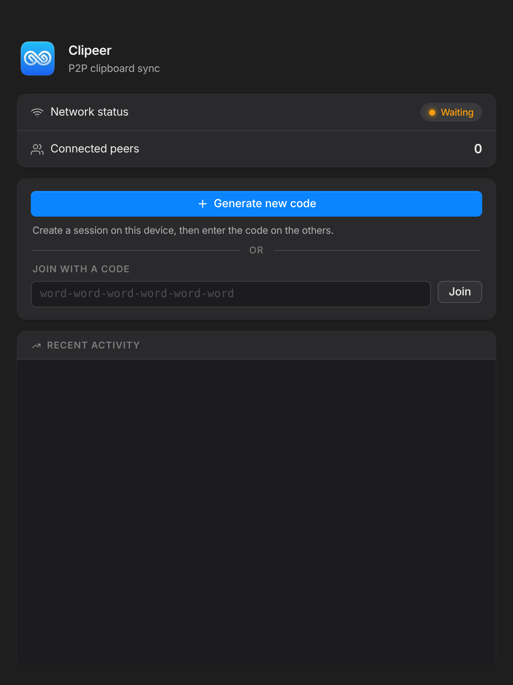
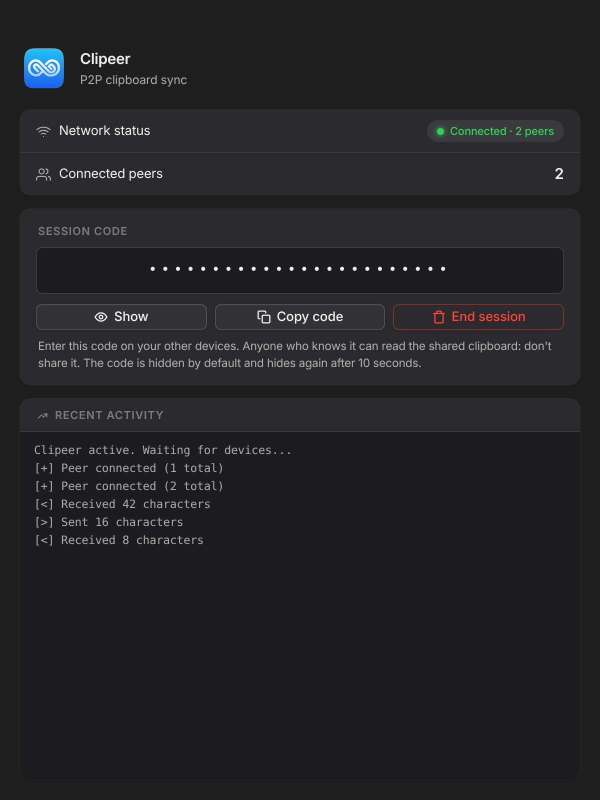
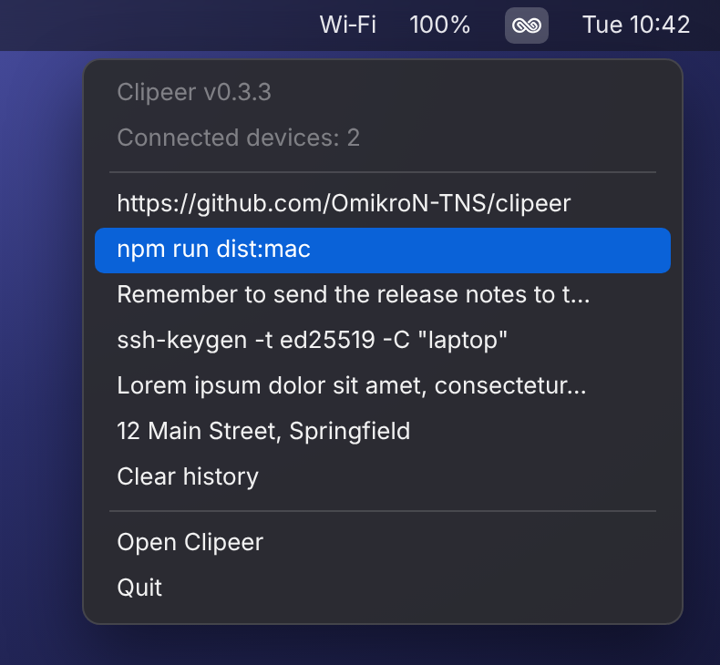

# Clipeer

Share your clipboard between your devices, peer to peer, with no server of your own.

Clipeer syncs copied text between computers on **different networks**. Devices find each other through the
[Hyperswarm](https://github.com/holepunchto/hyperswarm) distributed network, connect directly (hole punching), and every
message is end-to-end encrypted with a key derived from your session code.

## Screenshots

<p align="center">
  
  &nbsp;&nbsp;&nbsp;
  
  <br>
  <sub>Pairing a new device &nbsp;·&nbsp; Active session (the code is hidden until you click Show)</sub>
</p>

<p align="center">
  
  <br>
  <sub>Tray menu with the last copied items (illustration)</sub>
</p>

## Download

Get the latest build from the **[Releases](https://github.com/OmikroN-TNS/clipeer/releases/latest)** page. The file names
do not contain the version, so a new download simply replaces the old file. These links always point to the newest release:

| System | Direct link |
| --- | --- |
| Windows | [`Clipeer-win-x64.exe`](https://github.com/OmikroN-TNS/clipeer/releases/latest/download/Clipeer-win-x64.exe) |
| macOS (Apple Silicon) | [`Clipeer-mac-arm64.dmg`](https://github.com/OmikroN-TNS/clipeer/releases/latest/download/Clipeer-mac-arm64.dmg) |
| macOS (Intel) | [`Clipeer-mac-x64.dmg`](https://github.com/OmikroN-TNS/clipeer/releases/latest/download/Clipeer-mac-x64.dmg) |
| Linux | [`Clipeer-linux-x86_64.AppImage`](https://github.com/OmikroN-TNS/clipeer/releases/latest/download/Clipeer-linux-x86_64.AppImage) |

The builds are **not code-signed**, so your system will warn you the first time:

- **macOS:** the app is ad-hoc signed, not notarized. Open it once, then go to *System Settings → Privacy & Security*
  and click *Open Anyway*. If macOS says the app is damaged, run
  `xattr -cr /Applications/Clipeer.app` and open it again.
- **Windows:** SmartScreen → *More info* → *Run anyway*.
- **Linux:** make the file executable (`chmod +x Clipeer-*.AppImage`). On Wayland, install `wl-clipboard`
  (version 2.3 or newer on KDE Plasma 6.5+).

## How to use

1. Open Clipeer on the first device and click **Generate new code**.
2. On the other devices, paste the code in **Join with a code**.
3. Copy something on one device: it shows up in the clipboard of the others.

After pairing, Clipeer starts hidden in the tray / menu bar. Click the tray icon (or use its menu) to open the window,
see the last 10 copied items, or quit.

## Security notes

- Anyone who knows the session code can read the shared clipboard. Don't share it, and use **End session** to discard it.
- The code is hidden in the window by default and hides again 10 seconds after you reveal it. It is never added to the
  clipboard history shown in the tray.
- The local server behind the window requires a random token generated at every launch, so other programs and users on
  the same computer cannot read the code from it.
- The code is stored in plain text: `%APPDATA%\Clipeer\secret` on Windows, `~/.clipeer/secret` on macOS and Linux
  (override the folder with `CLIPEER_DIR`).
- Only text is synced, up to 1 MB per item. The history shown in the tray is kept in memory only.

## Development

Requires Node 22.

```bash
npm install
npm start
```

Local builds (run each on its own operating system):

```bash
npm run dist:mac     # dmg for arm64 and x64
npm run dist:linux   # AppImage
npm run dist:win     # NSIS installer (.exe)
```

## Releasing

The workflow in `.github/workflows/build.yml` builds Windows, macOS and Linux and publishes a GitHub Release.
To publish a new version, with everything committed or ready to commit:

```bash
bash scripts/release.sh 0.3.3 "What changed in this version"
```

The script sets the version in `package.json`, commits, pushes, creates the tag `v0.3.3` with your text as its message,
and pushes the tag. The workflow then builds the app and publishes the release: your text is the first thing in the
release notes, followed by the list of changes generated by GitHub. The app version is taken from the tag.

You can also run the workflow by hand from the **Actions** tab (*Run workflow*): it builds and uploads the files as
artifacts, without publishing a release.
